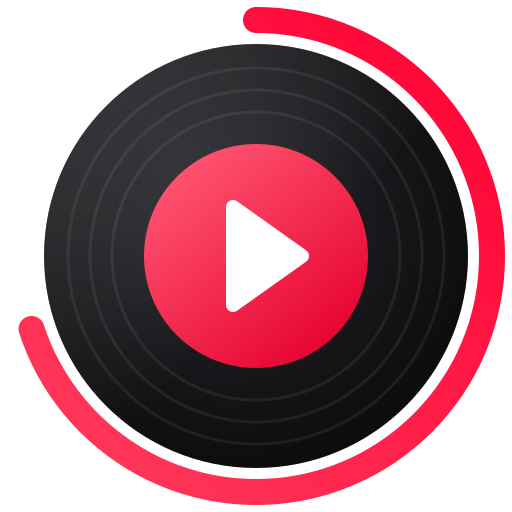

<p align="center">
  
</p>

<h1 align="center">Native YTM</h1>

<p align="center">
  <b>YouTube Music as a real Windows app.</b><br>
  No browser inside: Rust, drawn on the GPU. Open in a tenth of a second, at rest on a fraction of a core.
</p>

<p align="center">
  <a href="../../releases/latest"></a>
  
  
  
  
  
  
</p>

<p align="center">
  
</p>

## Why

Most desktop players for YouTube Music are a web browser in a window, with
a browser's appetite. Native YTM is a single 15 MB program: the interface is
drawn by the GPU, the audio is streamed, decoded and played by its own
engine, and the catalogue comes straight from YouTube Music's API. It starts
before you can let go of the mouse, plays in about 30 MB from the tray, and
sounds as good as your account allows.

## Features

**Sound**
- **Premium quality.** With Music Premium, 256 kb/s Opus or AAC. A song
  starts in under a second and switches up to Premium mid-song, without a
  gap, the full-window player showing it happen.
- **Songs kept on disk.** The last 100 songs you heard (or as many as you
  like) are kept at the best quality heard, and play from disk at once.
- **Gapless**, Opus and AAC, resampled to your device, levelled the way
  YouTube Music levels them.

**Lyrics and the full view**
- **Synced lyrics** that follow the song: the line being sung lit, the rest
  dim, the view gliding along. Click a line to play from there.
- **A full-window player**: the artwork large over a wash of its own colours,
  with what plays next or the lyrics beside it.

**Your music**
- Home, Explore, moods and charts, search with suggestions, albums,
  artists, playlists, all with infinite scrolling.
- Signed in: your playlists, Liked music, the library, likes, saving,
  subscribing, creating playlists, songs only Premium members can play.
- A queue that does what you expect: play next, drag to reorder, shuffle,
  repeat, and radio that keeps going when it runs out.

**At home on Windows**
- The media keys and the volume flyout, with the song's name and artwork.
- Closes to the tray and keeps playing. One copy at a time.
- **Discord**: "Listening to" the artist, with the artwork, the song and a
  progress bar on your profile.
- **Last.fm** scrobbling and now playing.
- Light animations throughout, each drawing frames only while it moves.

<p align="center">
  
  
</p>

## Light on the machine

Measured with the release build on a laptop drawing on Intel UHD graphics:

| | Memory | CPU (one core) | GPU |
| --- | --- | --- | --- |
| Open, idle | 101 MB | 0.2% | 0% |
| Playing | 110 MB | 3% | 0.6% |
| Full-window player, lyrics moving | 115 MB | 3.3% | 3% |
| Playing from the tray | 33 MB | 0.5% | none |

The interface draws a frame only when something on screen changes, and
never faster than the screen shows them; the system's Japanese, Chinese and
Korean fonts are mapped rather than loaded; artwork stays within a budget.

## Install

1. Download `native-ytm.exe` from [Releases](../../releases/latest) and run
   it. It is one file; it puts its settings in `%APPDATA%\native-ytm`.
   (Windows may ask before running a new download: **More info**, then
   **Run anyway**.)
2. **Sign in**, if you like (browsing, search and playback need no
   account). Google does not let third-party apps sign in to YouTube Music
   directly, so the app uses your browser's session, as
   [ytmusicapi](https://github.com/sigma67/ytmusicapi) does:
   - Open <https://music.youtube.com>, signed in, and press **F12**.
   - In **Network**, filter for `browse` and pick a request to
     `music.youtube.com`.
   - Copy its `cookie` request header (or *Copy as cURL*, or a
     `cookies.txt` export), and paste it into **Sign in** in the app.

   It is stored encrypted for your Windows account.
3. **Premium quality** wants [yt-dlp](https://github.com/yt-dlp/yt-dlp) and
   a JavaScript runtime it can use:

   ```bash
   winget install yt-dlp.yt-dlp OpenJS.NodeJS.LTS
   ```

**Discord** works with the Discord app running. **Last.fm** asks for an API
account of your own (free and instant at
<https://www.last.fm/api/account/create>): paste its key and secret in
Settings and press **Connect**.

## Keyboard

| Keys | |
| --- | --- |
| Space | Play or pause |
| Ctrl + Right / Left | Next / previous |
| Shift + Right / Left | Forward / back 10 seconds |
| Ctrl + Up / Down, M | Volume, mute |
| F, Esc | Open, close the full-window player |
| Q | The queue |
| L | Like |
| Ctrl + F or / | Search |
| Alt + Left / Right | Back / forward |

## Build

Rust 1.98 or newer, with the MSVC build tools:

```bash
cargo build --release
```

`target\release\native-ytm.exe` is the whole app.

<details>
<summary><b>How it works</b></summary>

| Part | Where | What |
| --- | --- | --- |
| Interface | `src/ui/` | egui views; they emit `Action`s, which `src/app.rs` applies after each frame |
| App state | `src/app.rs`, `src/queue.rs` | navigation, the queue, what plays next, preloading, the switch to Premium |
| Network | `src/backend.rs` | a two-thread tokio runtime; the interface never waits on it |
| API | `src/api/` | InnerTube (`WEB_REMIX`) requests and the parsers that turn renderers into the model; LRCLIB for synced lyrics |
| Streams | `src/stream.rs` | finds a stream for a song (below) |
| Audio | `src/player/` | range downloader, symphonia (MP4, WebM, AAC), libopus for Opus, rubato resampler, fastframe-audio output |
| Song cache | `src/cache.rs` | whole files kept on disk, the best quality heard, the least recently played going first |
| Desktop | `src/discord.rs`, `src/lastfm.rs`, `src/platform.rs` | Discord's local pipe, Last.fm's API, DPAPI, the app's identity for the media flyout |

**Streams.** The player endpoint is asked as one of the clients YouTube
serves direct addresses to without a JavaScript challenge (visionOS, then
Android VR), under a visitor id of its own; Opus (itag 251) is taken over
AAC (itag 140), and the last kilobyte is checked before the stream is
trusted. That takes about half a second. Premium's 256 kb/s streams (774
Opus, 141 AAC) and Premium members' songs are served only to the signed-in
web player, whose addresses need its JavaScript: yt-dlp fetches those with
the account's cookie (written for the seconds it runs, then removed). A song
starts on the quick stream; when the Premium one arrives, the engine decodes
it from the end of the three seconds already queued, 60 ms early, and
crossfades the overlap, so the join cannot click. The next song's Premium
stream is fetched while one plays.

**Frames.** egui runs a frame for every pointer movement. The vendored
eframe (`vendor/eframe`, search for "native-ytm patch") puts off a frame
asked for before the screen could show the last, and neither draws nor
presents a frame identical to the one on screen. Animations the app drives
are held to 60 frames a second (`theme::repaint_in` makes up for egui
shortening every delay by a frame). The vendored fastframe-fonts maps the
system's fallback fonts instead of reading them in.

**For development**, the app takes a few environment variables:
`NATIVE_YTM_ROUTE` opens pages or plays at start (`search:QUERY`,
`browse:ID`, `play:VIDEO_ID`, `explore`, `library`, `settings`, `queue`,
`lyrics`, `signin`, `full`, joined with `|`); `NATIVE_YTM_SHOT=out.png`
saves a screenshot after `NATIVE_YTM_SHOT_DELAY` ms and quits;
`NATIVE_YTM_SCROLL`, `NATIVE_YTM_SEEK`, `NATIVE_YTM_MUTE`;
`NATIVE_YTM_NO_DISCORD`; `NATIVE_YTM_PROFILE=DIR` runs a separate copy with
its own data; `NATIVE_YTM_WIGGLE=x,y` and `NATIVE_YTM_WHEEL=x,y` make up
pointer input; `NATIVE_YTM_NO_FRAME_SKIP` draws identical frames anyway.
`ytm-probe` is a console tool for when YouTube changes something: `dump`
prints what the parsers make of live pages, `play` resolves and plays a
stream (`--cookies FILE --premium` for the account's), `lyrics` looks lyrics
up, `logo` and `icon` draw the logo.

</details>

## Credits

[Spotifast](https://github.com/crmne/spotifast) and
[fastframe](https://github.com/crmne/fastframe) by Carmine Paolino (MIT), the
design this follows and its foundation. [egui and eframe](https://github.com/emilk/egui)
(MIT or Apache-2.0). [ytmusicapi](https://github.com/sigma67/ytmusicapi) and
[yt-dlp](https://github.com/yt-dlp/yt-dlp), for how YouTube Music works.
[libopus](https://opus-codec.org) (BSD) through
[unsafe-libopus](https://github.com/DCNick3/unsafe-libopus).
[LRCLIB](https://lrclib.net) for synced lyrics.
[th-ch/youtube-music](https://github.com/th-ch/youtube-music) for its Discord
application. Icons from [Lucide](https://lucide.dev) (ISC); the
[Inter](https://rsms.me/inter/) typeface (SIL OFL 1.1).

MIT licensed. An independent project, not affiliated with Google or YouTube.
