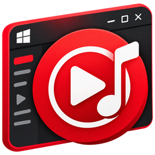
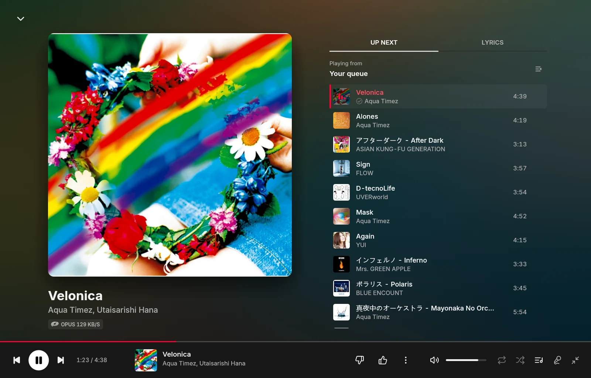
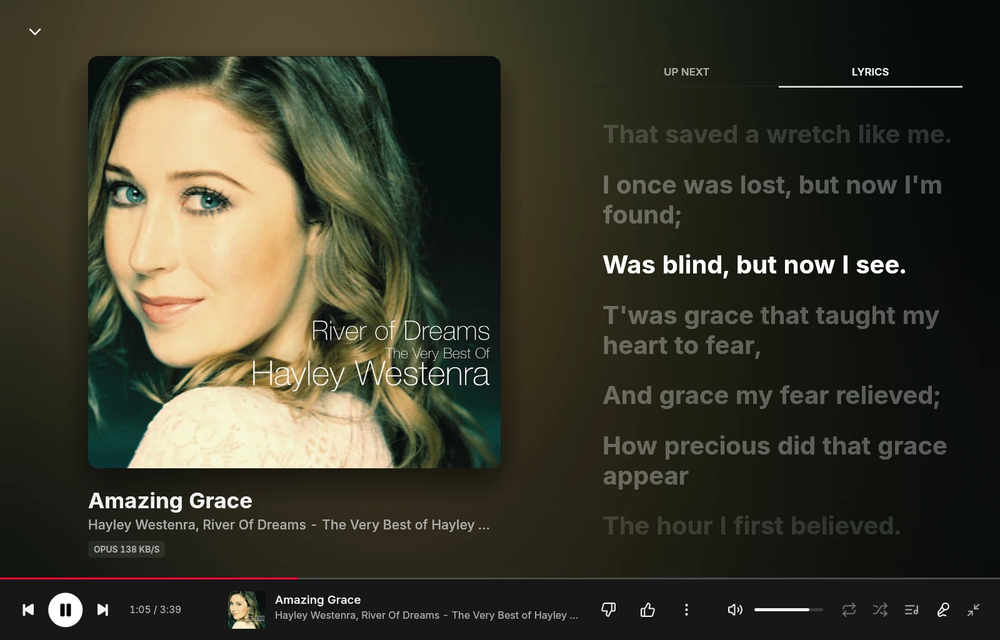
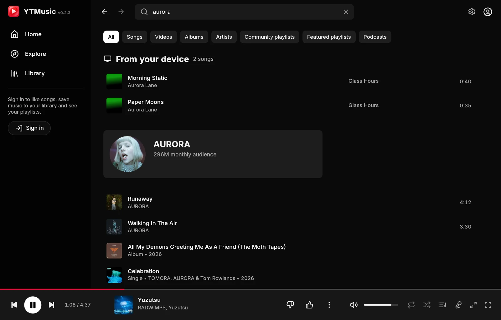

<p align="center">
  
</p>

<h1 align="center">Native YTM</h1>

<p align="center">
  <b>YouTube Music as a real Windows app.</b><br>
  No browser inside: Rust, drawn on the GPU. Open in a tenth of a second, at rest on a fraction of a core.
</p>

<p align="center">
  <a href="../../releases/latest"></a>
  
  
  
  
  
  
</p>

<p align="center">
  
</p>

## Why

Most desktop players for YouTube Music are a web browser in a window, with
a browser's appetite. Native YTM is a single 18 MB program: the interface is
drawn by the GPU, the audio is streamed, decoded and played by its own
engine, and the catalogue comes straight from YouTube Music's API. It starts
before you can let go of the mouse, plays in about 30 MB from the tray, and
sounds as good as your account allows.

## Features

**Sound**
- **Premium quality.** With Music Premium, 256 kb/s Opus or AAC. A song
  starts in under a second and switches up to Premium mid-song, without a
  gap, the full-window player showing it happen, codec symbol and all.
- **Gapless, or a smart crossfade.** Songs follow without a gap, or fade
  into one another where they go quiet: the last 15 seconds of one and the
  first 15 of the next are looked at, the silence between them cut, and
  the fade-out (or the next song's soft intro) overlapped, up to 12 seconds
  (an album still plays as one piece). Levelled the way YouTube Music
  levels them, never a click.
- **The codec, with its symbol**: Opus, AAC, FLAC, MP3, WAV, AIFF, ALAC or
  Vorbis, and the bitrate, under the title in the full-window player.
- **Equalizer.** Ten bands with presets (Bass boost, Vocal, Rock, Late
  night…) or a curve of your own, heard the moment you move a band.

**Offline**
- **Downloads.** Download a song, an album or a whole playlist, at the best
  quality your account gets; they're in **Library, Cached**, ticked
  wherever they appear, and play without the network.
- **Songs kept on disk.** The last 100 songs you heard (or as many as you
  like) stay on disk too, so they start at once and play offline.
- **Lyrics kept too**, once found: they show at once the next time, and
  offline. The next song's are looked up while one plays.
- **What it all takes**, in Settings: one bar of a colour per kind
  (downloads, songs kept, artwork, lyrics…) and the space left on the
  drive.
- **Knows when you're offline.** Downloaded songs carry on, the queue skips
  to the next song on disk, pages wait, and everything picks up again on its
  own when the connection is back.

**Lyrics and the full view**
- **Synced lyrics** that follow the song: the line being sung lit, the rest
  dim, the view gliding along. Click a line to play from there. Lines a
  little early or late? Move them half a second at a time from the corner
  of the lyrics; it is kept for that song.
- **Readings over Japanese lyrics** in the full-window player: how each
  word sounds, set small over it, in romaji or as furigana.
- **A full-window player**: the artwork large over a wash of its own colours,
  the year it came out beside the title, with what plays next or the lyrics
  beside it.
- **Full screen** (F11): the player alone, the bar and the pointer slipping
  away while the mouse rests and back the moment it moves.

**Music on this PC**
- Add the folders where you keep MP3, FLAC, M4A, Ogg, Opus, WAV or AIFF
  files: their songs, tags and cover art are in **Library, On this PC**,
  and come first when you search, under **From your device**.
- They play in the same queue as YouTube Music's, gapless or crossfaded,
  equalised and levelled (ReplayGain), with synced lyrics; when they run
  out, YouTube Music's radio carries on in the same vein. A scan reads only
  the files that changed.
- Search finds Japanese titles by how they read: "torikago" finds トリカゴ.
- Songs without artwork get their album's from Last.fm (or YouTube Music).
- **Albums and artists** as well as songs, and a page for each album: its
  cover, how it sounds (FLAC 24-bit 96 kHz…), its songs in order, and the
  artist's other albums here.
- **Watched folders.** Songs added, renamed, retagged or deleted show up on
  their own: Windows tells the app when a folder changes, so nothing runs
  in the meantime. A first scan reads several files at once.
- Artists lead to a page of their own, as on YouTube Music: their picture,
  their story up top (a few lines, the rest a click away), Last.fm's
  listeners, tags, popular songs, albums and similar artists, your plays,
  and their songs on this PC.

**Your music**
- Home, Explore, moods and charts, search with suggestions and your recent
  searches, albums, artists, playlists, all with infinite scrolling. Quick
  picks sits near the top of Home, wherever YouTube Music sends it.
- **Quick.** Home, Explore and the library open at once as they were last
  time, while the fresh copy loads; artwork comes in YouTube Music's own
  sizes, which arrive in about a tenth of a second; and a song you point
  at has its stream found meanwhile, so the click plays it at once (with
  Premium, the 256 kb/s stream takes over when it comes).
- Signed in: your playlists, Liked music, the library, likes, saving,
  subscribing, creating, renaming and deleting playlists, songs only
  Premium members can play.
- **Your stats**: your top artists, songs and albums over 7 days to all
  time, the plays day by day, from Last.fm or from the app's own count
  (which takes in the songs on this PC, and the time listened).
- A queue that does what you expect: play next, drag to reorder, shuffle,
  repeat, and radio that keeps going when it runs out.

**At home on Windows**
- The media keys and the volume flyout, with the song's name and artwork.
- Closes to the tray and keeps playing. One copy at a time. Starts with
  Windows if you like, straight to the tray.
- **Your YouTube Music history** gets what you play, as on the web.
- **Discord**: "Listening to" the artist, with the artwork, the song and a
  progress bar on your profile. Songs on this PC show their album's
  artwork too, found online, since Discord shows only pictures on the web.
- **Last.fm**: scrobbling and now playing, and in the player bar how many
  times you've played the song and the artist; on an artist's page, how
  often you've scrobbled them.
- **Updates in one click.** A new version shows in the top bar: one click
  downloads it, checks it against the digest GitHub publishes, and restarts
  into it, the music carrying on where it was.
- **Four themes**, all dark: Classic (YouTube Music's black and red),
  Midnight, Sakura and Matcha, picked from little pictures of each in
  Settings, and taken on at once.
- **A visualiser** rising from the top of the player bar as the music
  plays, in the theme's colours: Bars, Wave, Mirror or Aurora. A click on
  its button turns it off; a right-click picks the style. It draws at 30
  frames a second, and not at all while nothing plays.
- A soft glow follows the pointer over rows and cards.
- Settings in plain words, the technical ones tucked under Advanced.
- Light animations throughout, each drawing frames only while it moves.

<p align="center">
  
  
</p>

## Light on the machine

Measured with the release build on a laptop drawing on Intel UHD graphics:

| | Memory | CPU (one core) | GPU |
| --- | --- | --- | --- |
| Open, idle | 101 MB | 0.2% | 0% |
| Playing | 110 MB | 3% | 0.6% |
| Full-window player, lyrics moving | 115 MB | 3.3% | 3% |
| Playing from the tray | 33 MB | 0.5% | none |

The interface draws a frame only when something on screen changes, and
never faster than the screen shows them; the system's Japanese, Chinese and
Korean fonts are mapped rather than loaded; artwork stays within a budget.
Resizing the window makes some graphics drivers (Intel's among them) hold
on to a buffer for every size it passed through, hundreds of megabytes;
the app hands that memory back to Windows a second after a resize ends.

## Install

1. Download `native-ytm.exe` from [Releases](../../releases/latest) and run
   it. It is one file; it puts its settings in `%APPDATA%\native-ytm`.
   (Windows may ask before running a new download: **More info**, then
   **Run anyway**.)
2. **Sign in**, if you like (browsing, search and playback need no
   account). Google does not let third-party apps sign in to YouTube Music
   directly, so the app uses your browser's session, as
   [ytmusicapi](https://github.com/sigma67/ytmusicapi) does:
   - Open <https://music.youtube.com>, signed in, and press **F12**.
   - In **Network**, filter for `browse` and pick a request to
     `music.youtube.com`.
   - Copy its `cookie` request header (or *Copy as cURL*, or a
     `cookies.txt` export), and paste it into **Sign in** in the app.

   It is stored encrypted for your Windows account.
3. **Premium quality** wants [yt-dlp](https://github.com/yt-dlp/yt-dlp) and
   a JavaScript runtime it can use:

   ```bash
   winget install yt-dlp.yt-dlp OpenJS.NodeJS.LTS
   ```

**Discord** works with the Discord app running. **Last.fm** asks for an API
account of your own (free and instant at
<https://www.last.fm/api/account/create>): paste its key and secret in
Settings, Advanced, and press **Connect** under Sharing.

## Keyboard

| Keys | |
| --- | --- |
| Space | Play or pause |
| Ctrl + Right / Left | Next / previous |
| Shift + Right / Left | Forward / back 10 seconds |
| Ctrl + Up / Down, M | Volume, mute |
| F, Esc | Open, close the full-window player |
| F11 | Full screen |
| Q | The queue |
| L | Like |
| Ctrl + F or / | Search |
| Alt + Left / Right | Back / forward |

## Build

Rust 1.98 or newer, with the MSVC build tools:

```bash
cargo build --release
```

`target\release\native-ytm.exe` is the whole app.

<details>
<summary><b>How it works</b></summary>

| Part | Where | What |
| --- | --- | --- |
| Interface | `src/ui/` | egui views; they emit `Action`s, which `src/app.rs` applies after each frame |
| Themes | `src/theme.rs` | four palettes; the colours are read from the one chosen, so a change shows on the next frame |
| Visualiser | `src/visualiser.rs`, `src/ui/visualiser.rs` | the audio callback's last moments in a lock-free ring, an FFT into bands by octaves under a scale that follows the music, drawn as meshes |
| App state | `src/app.rs`, `src/queue.rs` | navigation, the queue, what plays next, preloading, the switch to Premium |
| Network | `src/backend.rs` | a two-thread tokio runtime; the interface never waits on it |
| API | `src/api/` | InnerTube (`WEB_REMIX`) requests and the parsers that turn renderers into the model; LRCLIB for synced lyrics |
| Streams | `src/stream.rs` | finds a stream for a song (below) |
| Audio | `src/player/` | range downloader (or a file read as it plays), symphonia (MP4, WebM, AAC, and MP3, FLAC, Vorbis, ALAC, WAV for local files), libopus for Opus, rubato resampler, the smart crossfade (`smart.rs`: where the songs go quiet), the equaliser (`eq.rs`, in the audio callback), fastframe-audio output |
| Music on this PC | `src/local.rs` | the folder scan (a thread at background priority), tags and pictures read once into an index, search (with readings of Japanese names), artwork found online |
| Updates | `src/update.rs` | the latest GitHub release, the download checked against its SHA-256 digest, the running program renamed aside for the new one |
| Lyric readings | `src/readings.rs` | Japanese words read longest match first from a table made from JMdict, then put in romaji or hiragana |
| Songs on disk | `src/cache.rs`, `src/lyrics.rs`, `src/kept_pages.rs` | downloads, and whole files kept from plays (the best quality heard, the least recently played going first); lyrics once found; Home and the library's pages as they last loaded |
| Stats | `src/stats.rs`, `src/ui/stats.rs` | the plays the app hears (one line of JSON each), summed over a stretch; Last.fm's own over the same |
| Folder watch | `src/watch.rs` | Windows' change notifications for the folders of music, a burst of changes settled into one look through them |
| Remembered | `src/personal.rs` | recent searches, and how far each song's lyrics are moved |
| Offline | `src/net.rs` | whether there is internet, from Windows' Network List Manager, asked when a request fails and while offline |
| Desktop | `src/discord.rs`, `src/lastfm.rs`, `src/platform.rs` | Discord's local pipe, Last.fm's API, DPAPI, the app's identity for the media flyout |

**Streams.** The player endpoint is asked as one of the clients YouTube
serves direct addresses to without a JavaScript challenge (visionOS, then
Android VR), under a visitor id of its own; Opus (itag 251) is taken over
AAC (itag 140), and the last kilobyte is checked before the stream is
trusted. That takes about half a second. Premium's 256 kb/s streams (774
Opus, 141 AAC) and Premium members' songs are served only to the signed-in
web player, whose addresses need its JavaScript: yt-dlp fetches those with
the account's cookie (written for the seconds it runs, then removed). A song
starts on the quick stream; when the Premium one arrives, the engine decodes
it from the end of the three seconds already queued, 60 ms early, and
crossfades the overlap, so the join cannot click. The next song's Premium
stream is fetched while one plays.

**History.** A song that starts is reported the way the web player does:
the signed-in player request, then the playback address it names.

**Frames.** egui runs a frame for every pointer movement. The vendored
eframe (`vendor/eframe`, search for "native-ytm patch") puts off a frame
asked for before the screen could show the last, and neither draws nor
presents a frame identical to the one on screen. Animations the app drives
are held to 60 frames a second (`theme::repaint_in` makes up for egui
shortening every delay by a frame). The vendored fastframe-fonts maps the
system's fallback fonts instead of reading them in.

**For development**, the app takes a few environment variables:
`NATIVE_YTM_ROUTE` opens pages or plays at start (`search:QUERY`,
`browse:ID`, `play:VIDEO_ID`, `explore`, `library`, `settings`, `queue`,
`lyrics`, `signin`, `full`, `fullscreen`, `cached`, `device`, `deviceview:N` (0 songs, 1 albums, 2 artists), `artist:NAME`, `localalbum:N`, `localradio:N`, `stats` (`stats:app` for the app's own), `recent` (the empty search box, focused), `local:N` to
play the songs on this PC from the Nth, `update` to install an update once
found, and `download` for the song playing, joined with `|`);
`NATIVE_YTM_VERSION` makes the app believe it is that version (to be offered
the latest release); `NATIVE_YTM_SHOT=out.png`
saves a screenshot after `NATIVE_YTM_SHOT_DELAY` ms and quits;
`NATIVE_YTM_SCROLL`, `NATIVE_YTM_SEEK`, `NATIVE_YTM_MUTE`;
`NATIVE_YTM_NO_DISCORD`; `NATIVE_YTM_PROFILE=DIR` runs a separate copy with
its own data; `NATIVE_YTM_WIGGLE=x,y`, `NATIVE_YTM_WHEEL=x,y` and
`NATIVE_YTM_CLICK=x,y[,seconds]` make up pointer input; `NATIVE_YTM_NO_FRAME_SKIP` draws identical frames anyway;
`NATIVE_YTM_OFFLINE` makes the app believe it is offline.
`ytm-probe` is a console tool for when YouTube changes something: `dump`
prints what the parsers make of live pages, `play` resolves and plays a
stream (`--cookies FILE --premium` for the account's), `lyrics` looks lyrics
up, `lastfm CONFIG_DIR artist NAME` shows what an artist page reads from
Last.fm, `history VIDEO_ID --cookies FILE` checks the history report, `logo` and
`icon` write the icon out.

</details>

## Credits

[Spotifast](https://github.com/crmne/spotifast) and
[fastframe](https://github.com/crmne/fastframe) by Carmine Paolino (MIT), the
design this follows and its foundation.
[Symphonia](https://github.com/pdeljanov/Symphonia) (MPL-2.0) for demuxing
and decoding. [egui and eframe](https://github.com/emilk/egui)
(MIT or Apache-2.0). [ytmusicapi](https://github.com/sigma67/ytmusicapi) and
[yt-dlp](https://github.com/yt-dlp/yt-dlp), for how YouTube Music works.
[libopus](https://opus-codec.org) (BSD) through
[unsafe-libopus](https://github.com/DCNick3/unsafe-libopus).
[LRCLIB](https://lrclib.net) for synced lyrics.
[JMdict](https://www.edrdg.org/jmdict/j_jmdict.html) by the EDRDG
(CC BY-SA 4.0) for the readings of Japanese lyrics.
[th-ch/youtube-music](https://github.com/th-ch/youtube-music) for its Discord
application. Icons from [Lucide](https://lucide.dev) (ISC); the Last.fm mark
from [Simple Icons](https://simpleicons.org) (CC0); the Opus and AAC symbols
from Wikimedia Commons (the other formats' are the app's own). Those marks belong to their owners. The
[Inter](https://rsms.me/inter/) typeface (SIL OFL 1.1).

MIT licensed. An independent project, not affiliated with Google or YouTube.
