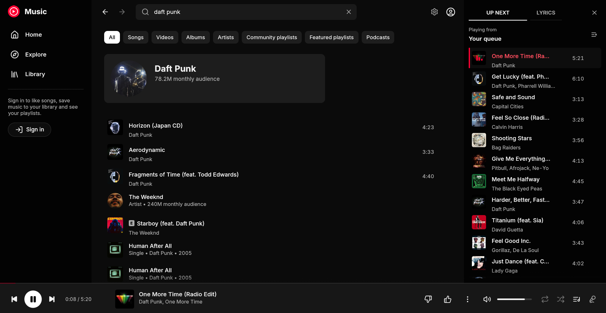

# native-ytm

A lightweight, native YouTube Music client for Windows, built the way
[Spotifast](https://github.com/crmne/spotifast) is: Rust and
[egui](https://github.com/emilk/egui) on Spotifast's own foundation,
[fastframe](https://github.com/crmne/fastframe). There is no browser engine
and no webview. The interface is drawn natively with OpenGL, the catalogue
comes from YouTube Music's JSON API, and the audio is streamed, decoded and
played by a small engine in Rust.

This is a personal experiment, not affiliated with Google or YouTube.



## What it does

- **Home, Explore, search** (with filters and suggestions), **albums,
  artists, playlists**, moods and charts, with infinite scrolling.
- **Playback** straight from YouTube's servers: Opus at about 130 kb/s
  (or AAC at 128), resampled to whatever rate the output device runs at,
  with **gapless** transitions (the next song is fetched and decoded before
  this one ends), instant seeking, and YouTube Music's loudness
  normalisation.
- **Premium quality**: signed in with a Music Premium account, 256 kb/s
  Opus (or AAC), and the songs only Premium members can play.
- **Queue**: play next, add to queue, drag to reorder, shuffle, repeat
  (all or one), and **autoplay radio** that keeps going when the queue runs
  out, as YouTube Music does.
- **Synced lyrics**, as Apple Music shows them: the line being sung lit,
  the view following it, a click on a line to play from there (from
  [LRCLIB](https://lrclib.net); YouTube's own lyrics otherwise).
- **A full-window player**: the artwork large over a wash of its colours,
  with what plays next or the lyrics beside it.
- **Discord**: "Listening to" the artist, with the artwork, the song and a
  progress bar on your profile.
- **Last.fm** scrobbling, with now-playing updates.
- **Signed in** (optional): your playlists in the sidebar, Liked music,
  the Library (playlists, songs, albums, artists, subscriptions, history),
  like and dislike, save albums and playlists, subscribe to artists, save to
  a playlist, create playlists, remove songs from your own playlists.
- **Windows integration**: the media keys and the volume overlay's
  controls (System Media Transport Controls), named and with the app's icon
  (a Start menu shortcut carries the app's id, which is how Windows names
  an app there), a tray icon that keeps the music playing with the window
  closed, one running copy (a second launch brings the window back), and a
  dark title bar.
- The queue and position are restored at the next start.

## How it works

| Part | Where | What |
| --- | --- | --- |
| Interface | `src/ui/` | egui views; they emit `Action`s, which `src/app.rs` applies after each frame |
| App state | `src/app.rs`, `src/queue.rs` | navigation, the queue, what plays next, preloading, autoplay |
| Network | `src/backend.rs` | a two-thread tokio runtime; the interface never waits on it |
| API | `src/api/` | InnerTube (`WEB_REMIX`) requests and the parsers that turn renderers into the model |
| Streams | `src/stream.rs` | finds an audio address for a video id (see below) |
| Audio | `src/player/` | HTTP range downloader, symphonia demuxers (MP4, WebM) and AAC decoder, libopus for Opus, rubato resampler, fastframe-audio output |
| Lyrics | `src/api/lrclib.rs`, `src/ui/lyrics.rs` | LRCLIB lookups and LRC parsing; the synced view |
| Desktop | `src/discord.rs`, `src/lastfm.rs`, `src/platform.rs` | Discord's IPC pipe, Last.fm's API, DPAPI, the app's identity |
| Artwork | `src/images.rs` | fetched and decoded off the interface thread, cached on disk, dropped from memory when unused |

### Getting the audio

YouTube serves direct audio addresses to some of its own clients without
the JavaScript challenge or proof-of-origin token the web player needs.
`src/stream.rs` asks the player endpoint as one of those (visionOS, then
Android VR), signed out and under a visitor id of its own, takes the Opus
stream (itag 251, or AAC, itag 140), and checks the last kilobyte before
trusting it, since some clients' addresses stop working after the first
megabyte. This takes about half a second.

Opus comes in WebM, which symphonia demuxes; symphonia has no Opus
decoder, so the packets go to libopus, through
[unsafe-libopus](https://github.com/DCNick3/unsafe-libopus), libopus's C
translated to Rust, so the build needs no C compiler or CMake.

Premium's 256 kb/s streams (itag 774, Opus, and 141, AAC) and songs only
Premium members can play are served only to the signed-in web player,
whose addresses need its JavaScript run. With **Premium quality** on (in
Settings) and an account signed in, the app asks
[yt-dlp](https://github.com/yt-dlp/yt-dlp) for them with the account's
cookie, written to a file in `%LOCALAPPDATA%\native-ytm\cache\scratch`
for the few seconds yt-dlp runs and removed after. That takes four or
five seconds a song, so the next song is resolved while one plays and
starts at once. Premium members' songs go this way whatever the setting.

YouTube changes which clients work. When none does, the app falls back to
yt-dlp if it is installed (it is looked for on `PATH`, or set its path in
Settings). yt-dlp needs a
JavaScript runtime for YouTube; if Deno is not installed and Node is, the
app tells yt-dlp to use Node. Keep yt-dlp current (`yt-dlp -U`, or your
package manager): an old one finds addresses that YouTube cuts off after the
first megabyte, which the app detects and reports. To fix the native path, update the client
list in `PlayerClient::defaults` (`src/api/client.rs`) from yt-dlp's
`_base.py`.

## Signing in

Google no longer lets third-party apps sign in to YouTube Music with OAuth
in a way that works for this API, so the app signs in the way
[ytmusicapi](https://github.com/sigma67/ytmusicapi) does: with your
browser's cookie.

1. Open <https://music.youtube.com> in your browser, signed in.
2. Press F12, open **Network**, and filter for `browse` (click around if
   the list is empty).
3. Select a request to `music.youtube.com` and copy the value of the
   `cookie` request header. (*Copy as cURL* or a `cookies.txt` export also
   work.)
4. In the app: **Sign in**, paste, **Sign in**.

The cookie is stored encrypted with Windows DPAPI, readable only by your
Windows account, in `%APPDATA%\native-ytm\config\account.bin`. Signing out
of YouTube in that browser profile ends the app's session too.

## Discord and Last.fm

**Discord** works with the Discord app running and nothing to set up: the
status reads "Listening to" the artist, and the profile card shows the
artwork, the title, the artist and a progress bar (Discord draws the bar
for listening activities with a start and an end). Paused, nothing shows.
The name Discord gives the activity is that of the Discord application
whose ID the app uses: by default the "YouTube Music" application of
[th-ch/youtube-music](https://github.com/th-ch/youtube-music); Settings
takes the ID of one of your own instead.

**Last.fm** needs an API account of your own (Last.fm gives one at once at
<https://www.last.fm/api/account/create>; any name and description do).
Paste its API key and shared secret into Settings and press **Connect**;
Last.fm asks in the browser whether to allow the app, and the app picks up
the session when you do. Songs scrobble after half their length or four
minutes, whichever comes first, as Last.fm asks; scrobbles wait in a file
while Last.fm cannot be reached. The key, the secret and the session are
stored encrypted with DPAPI, in `lastfm.bin`.

## Building

You need Rust 1.98 or newer and the MSVC build tools.

```bash
cargo build --release
```

The executable is `target\release\native-ytm.exe`, one file with
everything inside.

`ytm-probe` is a console tool for when YouTube changes something:

```bash
cargo run --release --bin ytm-probe -- dump search "daft punk" songs
```

Run it without arguments to see its commands (`dump` prints what the
parsers make of live pages, `play` resolves and plays a stream, `icon`
redraws `assets/app.ico`).

To check the interface without clicking through it, the app takes a few
environment variables (any build): `NATIVE_YTM_ROUTE` opens a page or
plays something at start (`search:QUERY`, `browse:ID`, `play:VIDEO_ID`,
`explore`, `library`, `settings`, `queue`, `lyrics`, `signin`, `full`, joined with
`|`), `NATIVE_YTM_SHOT=out.png` saves a screenshot after
`NATIVE_YTM_SHOT_DELAY` milliseconds and quits, `NATIVE_YTM_SCROLL` scrolls
the page, `NATIVE_YTM_SEEK` jumps into the song, `NATIVE_YTM_MUTE` plays
silently, and `NATIVE_YTM_NO_DISCORD` keeps the run off Discord.

`ytm-probe play VIDEO_ID --cookies cookies.txt --premium` checks the
account's streams, and `ytm-probe lyrics TITLE ARTIST` the lyrics lookup.

## Keyboard

| Keys | Does |
| --- | --- |
| Space | Play or pause |
| Ctrl + Right / Left | Next / previous song |
| Shift + Right / Left | Forward / back 10 seconds |
| Ctrl + Up / Down | Volume |
| M | Mute |
| Ctrl + F or / | Search |
| Alt + Left / Right, mouse back / forward | Back / forward |
| Q | Show the queue |
| F | Open or close the full-window player (Esc closes it) |
| L | Like the song |
| Ctrl + R or F5 | Reload the page |

## Where things are kept

- Settings, the queue, the sign-in and Last.fm: `%APPDATA%\native-ytm\config\`
- Artwork cache and logs: `%LOCALAPPDATA%\native-ytm\cache\`
- The Start menu shortcut: `%APPDATA%\Microsoft\Windows\Start Menu\Programs\Native YTM.lnk`

What leaves the machine besides YouTube's own traffic: the title, artist,
album and length of songs whose lyrics are shown, to LRCLIB (Settings turns
it off); what plays, to the Discord app on this computer, which shows it to
your friends; and, once connected, scrobbles to Last.fm.

## Footprint

Measured on this machine with the release build: a 15 MB executable, the
window up about 0.1 s after launch, about 0.2% of one core when idle and
4% while playing with the window open (7% in the full-window player with
synced lyrics moving, 0.3% closed to the tray), and about 160 MB of private
memory with the window open (87 MB in the tray). Some 58 MB of that is the
system fonts for Chinese, Japanese, Korean and other scripts, loaded so
every title draws.

## Limits

- Audio only. Premium's 256 kb/s streams and Premium members' songs need
  yt-dlp (and a JavaScript runtime it can use, Deno or Node).
- No video, no podcasts' episode lists beyond what pages show, no
  uploads, no offline downloads.
- YouTube changes its API without notice. The parsers look for item
  renderers wherever they are rather than at fixed paths, which survives
  most changes; stream access is the part most likely to need updating.

## Credits

- [Spotifast](https://github.com/crmne/spotifast) and
  [fastframe](https://github.com/crmne/fastframe) by Carmine Paolino (MIT):
  the design this follows, and the crates for audio output, media controls,
  the tray, fonts, icons and the window shell.
- [ytmusicapi](https://github.com/sigma67/ytmusicapi) and
  [yt-dlp](https://github.com/yt-dlp/yt-dlp): what YouTube Music's API looks
  like, and which clients still get streams.
- [libopus](https://opus-codec.org) (BSD), by way of
  [unsafe-libopus](https://github.com/DCNick3/unsafe-libopus), for Opus.
- [LRCLIB](https://lrclib.net) for synced lyrics, and
  [th-ch/youtube-music](https://github.com/th-ch/youtube-music) for its
  Discord application.
- Icons from [Lucide](https://lucide.dev) (ISC). Interface font
  [Inter](https://rsms.me/inter/) (SIL OFL 1.1), bundled by fastframe-fonts.
